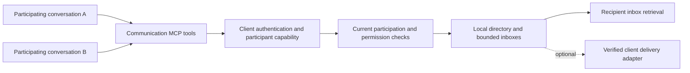

- [x] Inspect current client identity, MCP session lifecycle, virtual servers, privacy gates, and recent conversation plans.
- [x] Check official MCP documentation and optional adapter examples for identity and delivery limitations.
- [x] Compare within-client and cross-client scopes; propose a minimal first release.
- [x] Incorporate the user's clarification: the core feature supports generic clients; app-specific integrations are optional.
- [ ] Phase 0: prove portable enrollment and messaging with two generic participants, including shared/stateless transport.
- [ ] Phase 1: implement participant capabilities and bounded same-client mailboxes.
- [ ] Phase 2: expose MCP tools, permissions, and minimal desktop controls; verify two-session exchange.
- [ ] Phase 3: optionally add proven client-specific delivery adapters, such as Claude Channels.
- [ ] Future decision: consider explicit cross-client collaboration spaces after validating the within-client workflow.
- [ ] Plan Review after implementation: compare every specified behavior with the code and implement omissions.
- [ ] Test Coverage Review after implementation: cover modified paths, edge cases, and failures.
- [ ] Bug Hunt after implementation: inspect identity, authorization, lifecycle, races, bounds, and privacy.
- [ ] Run applicable local Rust, frontend, website, and native-client checks before any implementation commit.
- [ ] Commit and push completed, validated implementation and automatic catalog updates, preserving unrelated changes.
- [x] Review and validate this planning document for its separate documentation-only commit and push.

# Session communication within and across clients

Date: 2026-10-29. Status: proposed feature; this task delivers a plan only, with no application changes. Initial code inspection: `c3a49e10`; client-neutral revision based on user clarification, reviewed at `5a6f2fe5`.

## Recommendation

Build **client-neutral session communication**, initially scoped to participants sharing one configured LocalRouter client. Any client that can call the communication tools and retain its participant capability can publish a short description, discover peers, exchange direct messages, and reply. No Claude-specific identity, hook, channel, or lifecycle event is required by the core protocol.

Defer cross-client access until the first workflow is useful. Later, add explicit collaboration spaces containing selected LocalRouter client IDs. Do not introduce a global directory or infer permission from app brand, project path, or shared machine.

There are two independent axes: **application compatibility** (generic clients from the start) and **sharing scope** (one configured client first, explicit cross-client spaces later). Supporting arbitrary apps does not authorize communication between different LocalRouter credentials. Claude Channels and similar mechanisms are optional delivery adapters on the same broker.

The product promise is: **“Participating sessions can find one another and exchange messages through LocalRouter.”** Participation is explicit protocol enrollment; universal enumeration of open app tabs and automatic interruption are not generic MCP capabilities.

## What the user experience should be

1. Enable Session Communication on a configured LocalRouter client. Explain that participating sessions using this credential share a communication scope, including sessions in different apps or projects.
2. In two conversations, ask them to participate as “Implement authentication” and “Review authentication tests.” Each calls the join tool and retains its own participant capability. A cooperating host can manage this automatically through the same protocol; optional adapters may improve enrollment and lifecycle handling.
3. The implementation session lists peers and sees the reviewer’s deliberately published name, brief task description, recent activity, and delivery capability.
4. It sends: “I changed the token-refresh interface. Please check the retry behavior.”
5. The reviewer checks its inbox, or receives an event through a supported adapter, and replies against the original message ID.
6. The sender can distinguish queued, collected, and replied messages. Neither session receives the other’s transcript, credentials, filesystem access, or tool permissions.

Enrollment can be explicit per conversation without a manual LocalRouter UI action each time: the agent can call the join tool when asked to collaborate. The generic fallback passes the server-issued capability on later tool calls, even when several conversations share a connection. Existing sessions may require configuration reload or restart to load tools; verify their actual callable catalog. Optional integration configuration stays at the approved project scope unless the user requests otherwise.

Client-neutral does not mean protocol-free. MCP is the initial tool surface. An inference-only client that cannot call tools does not automatically become a participant merely because its requests pass through LocalRouter. Existing MCP-via-LLM support can be evaluated as another tool adapter; it must use the same explicit participant capability rather than inferred history as identity.

Do not build project rooms, broadcasting, shared transcripts, automatic task delegation, spawning agents, or a workflow scheduler in v1. Communication coordinates independent sessions; file conflicts and their execution remain the sessions’ responsibility.

## Scope choice

| Choice | Benefit | Cost | Recommendation |
| --- | --- | --- | --- |
| Same configured client | Sessions in any compatible app collaborate within one existing policy boundary | Must maintain separate enrolled participants and describe delivery honestly | First release |
| Explicit cross-client spaces | Sessions with different credentials/tools/models cooperate | Adds membership, bilateral policy, provider/privacy boundaries, and revocation cases | Later, using the same broker |
| All clients discover each other | Minimal setup | Exposes unrelated sessions and bypasses existing credential boundaries | Do not offer |

A “client” here means a saved LocalRouter credential and configuration, not a software brand. Two configurations of the same app with different credentials are cross-client. Different apps sharing one credential are within one client. Separate client entries remain the way to separate trust boundaries in v1.

## Current code and protocol constraints

| Finding | Consequence | Evidence |
| --- | --- | --- |
| `Client` is persistent configuration; gateway sessions are runtime connections | Neither is inherently one user conversation | `crates/lr-config/src/types.rs`, `crates/lr-clients/src/manager.rs` |
| Legacy SSE and stateful Streamable HTTP can separate connections; headerless/stateless paths can share `client_id` | Use application-level participant capabilities across all transport modes | `crates/lr-server/src/routes/mcp.rs`, `crates/lr-mcp/src/gateway/gateway.rs`, `gateway/types.rs` |
| Monitor conversation groups are bounded diagnostic correlation and can be inferred | Never use them as messaging addresses or authorization identity | `crates/lr-monitor/src/conversation.rs`, `plan/2026-10-29-MONITOR_CONVERSATION_BEHAVIOR.md` |
| Virtual MCP servers already provide tools, instructions, per-session state, and permission hooks | Implement as a small built-in virtual server plus local broker | `crates/lr-mcp/src/gateway/virtual_server.rs` |
| Virtual tool dispatch receives client identity but no generic participant authentication | Resolve the participant capability against that client in a narrow invocation context | `crates/lr-mcp/src/gateway/gateway_tools.rs` |
| Scoped notifications already exist, but the current stdio bridge only forwards sequential HTTP requests | Existing bridges cannot be assumed to receive push events or preserve conversation identity | `gateway/types.rs`, `crates/lr-mcp/src/bridge/stdio_bridge.rs` |
| Restricted privacy profiles already reject MCP ingress | Preserve this restriction on every new adapter/broker ingress | `crates/lr-server/src/privacy.rs`, `crates/lr-config/src/client_security.rs` |

Older MCP transport sessions describe client/server interactions, not user conversations. Revision 2026-07-28 removes protocol-level HTTP sessions, reinforcing the need for an application-level participant identity. See the official [older session contract](https://modelcontextprotocol.io/specification/2025-11-25/basic/transports#session-management) and [current HTTP transport](https://modelcontextprotocol.io/specification/2026-07-28/basic/transports/streamable-http).

MCP resource updates are application-controlled signals; they do not guarantee a model turn. Use tool-based inbox retrieval as the portable baseline. Adding virtual resources would also expand the existing tool-only virtual-server interface. See [MCP resources](https://modelcontextprotocol.io/specification/2026-07-28/server/resources).

## Identity and lifecycle

Keep these identities distinct: authenticated `client_id`, public LocalRouter `participant_id`, secret participant capability, participant generation, and optional host/native-conversation binding. A participant is an explicitly enrolled communication identity; the core does not certify which native chat window owns it.

- `SessionJoin` without a capability creates a participant with a public opaque ID and a separate cryptographically random bearer capability. A supplied invalid or expired capability fails rather than silently creating a replacement. Scope the capability to its authenticated client and participant generation; a public directory ID never authorizes operations. Display names and task descriptions are untrusted metadata.
- Every peer operation requires current client authentication plus the participant capability, or an equivalent verified host-held binding. The server derives the sender from that proof; never accept a caller-selected `from_session_id` as identity. Another participant's public ID only selects a destination.
- In portable mode, the join result returns the capability and subsequent tool arguments carry it. This works over shared or stateless connections and requires no native session ID. Retaining the handle in the conversation is explicit client/agent protocol state, not inferred identity.
- In optional host-managed mode, the host retains and attaches the capability outside model-visible arguments/results. A per-conversation adapter can bind it to a native session. Do not use an MCP transport key or client-wide gateway session as a substitute for that binding.
- Portable mode necessarily exposes its own capability to the host and potentially its model/provider context. Never place capabilities in server-generated directory entries, peer-visible fields, or receipts; redact known capability fields from Monitor, approvals, events, errors, replay, logs, indexing, and Memory capture paths. Instruct participants never to share their capability. Arbitrary message text can itself contain caller-supplied secrets; do not promise perfect detection of those or secrecy from client-managed transcripts. Schemas may name the capability argument but never contain another participant's value.
- A lease records recent participation, not proof that an app tab remains loaded. Successful participant operations renew it; a cooperating host can refresh it while active. Show “recently active” or “waiting for inbox check.” An adapter may additionally report connectivity, without implying model attention.
- Transport reconnect is independent of participation: the same valid capability can continue an unexpired participant. Explicit leave or lease expiry revokes that capability/address. A new join creates a new generation/address, and old messages never redirect to it. A lost join response may leave an orphan until expiry.
- Generic clients cannot reliably report every close, clear, fork, reset, or compaction. If capability ownership is lost or uncertain, enroll anew; never recover an inbox from a public ID, guessed native ID, or transcript correlation. Copying a capability into a fork denotes the same participant; independent forks/subagents must join separately. Host adapters can improve these lifecycle guarantees where supported.
- Disabling the feature/client, deleting the client, configured credential expiry, or credential revocation ends participation. Every request needs valid authentication; ordinary OAuth access-token expiry rejects that request, while successful refresh can restore access to an unexpired participant. Crashes rely on lease expiry. LocalRouter restart clears participants and mailboxes in v1.

Sharing one client credential is already sharing an authentication boundary. Participant capabilities prevent accidental routing and ordinary public-ID spoofing; this feature does not promise isolation against a malicious host controlling sessions under that credential.

## Proposed tools and message contract

Names below are proposals, to be aligned with existing built-in naming during implementation.

| Tool | Contract |
| --- | --- |
| `SessionJoin` | Without an existing capability, create a participant; with a valid one, update its name/purpose or renew participation. Return public ID, delivery mode, and the capability in portable mode |
| `SessionList` | Return only visible, enrolled peers in this client’s authorized scope; exclude self; paginate |
| `SessionSend` | Send plain text to one recipient, with a request idempotency key and optional `reply_to`; return message ID and queued status |
| `SessionReceive` | Fetch this participant's bounded page of messages and receipt events; accept acknowledgments for previously collected IDs; never select another participant's inbox |
| `SessionLeave` | Revoke this enrollment/address and capability and purge its pending inbox; an authenticated client can join again as a fresh participant |

The envelope contains a server message ID, trusted sender/recipient identities and generations, server time, expiry, plain-text body, and optional reply linkage. The server validates that `reply_to` belongs to an exchange visible to both participants. No attachments, remote URLs fetched by LocalRouter, transcript references, automatic execution, or structured action payloads. Plain-text code snippets are valid messages.

`SessionSend` is nonblocking with respect to the recipient. A recipient may reply later; sender tools never wait indefinitely for a model response. Use immediate inbox fetch in v1; bounded waiting can be added only if real client testing justifies it.

Use at-least-once collection until acknowledgment, rather than deleting before a tool response reaches the caller. Acknowledgment means collection, not understanding or successful work. Scope idempotency to sender generation and request key; a retry with a different payload fails. Retain bounded deduplication records for a documented retry window and return a clear result for a duplicate already expired or revoked.

Status vocabulary: **queued**, **collected** (fetched by the recipient tool/adapter), **acknowledged** (explicit recipient-agent receipt), **replied**, and **expired/revoked**. An optional channel handoff means only that the adapter wrote to its transport. Neither adapter collection nor handoff proves model consumption. A successful socket write is never “read” or “acted on.” No durable or exactly-once promise is made.

Send bounded status receipts to the sender's `SessionReceive` feed, with an explicit message/receipt event discriminator, so it can observe collection, acknowledgment, reply, and expiry after the initial queued result. Apply policy and generation checks to receipts too, avoid recursive receipts for receipts, and expire them within the same memory and retention budget. Once receipt history expires, return status unavailable rather than inventing a delivery outcome.

Use explicit text/byte/count limits from the first implementation. Initial values to validate: 4 KiB text per message, 100 queued messages or 512 KiB per participant (first limit wins), 4 MiB per client, 16 MiB globally, 15-minute message expiry, 20 sends per minute per sender, and 60 per recipient. Bound participants, directory pages, receipt history, deduplication records, and cleanup work as well. Reject a full inbox; never silently discard pending messages to accept a new one. Use a monotonic clock for runtime expiry.

## Permission and privacy behavior

- Add a default-Off per-client Session Communication setting. Reuse Off/Ask/Allow conventions. New enrollment requires enabled policy and current client authentication; updating a participant, listing, sending, and receiving also require its valid capability or host binding. Sending and receiving check current policy for both parties.
- With Ask, enrollment needs a participation approval for that logical participant; an agent-supplied name is not proof of a native conversation. The first send establishes a separate exchange grant covering the specific sender, recipient, scope, and participant generations; the approved exchange can include replies. Tool-name-only session approval is too broad. Inbox reads/receipts recheck that grant without prompting for every collection.
- Recheck current policy at enqueue, collection, and acknowledgment. Revocation removes visibility, invalidates grants, and purges undelivered content involving the revoked participant. Use the same unavailable response for hidden, expired, or unknown targets when the caller is unauthorized to distinguish them.
- Render peer messages as attributed untrusted content. They convey no system authority, approval, credentials, or access to the recipient’s tools. Prevent raw markup from impersonating host-generated envelopes. Enforce loop/rate budgets for automated replies; no default auto-reply loop or recursive delegation.
- Directory entries publish only supplied short names and purposes alongside public participant metadata. Do not derive directory titles from Monitor prompts, read transcripts, or expose roots, native IDs, capability values, model configuration, or client secrets there.
- Keep inboxes in bounded memory only. Do not automatically write messages to Memory, searchable context stores, replay payloads, or tool-result indexing. Mark all communication tools non-indexable and review generic tool-call capture paths as well.
- Monitor may record bounded IDs, sizes, timing, and outcome under current privacy settings; message bodies are omitted by default. Any later body inspection needs explicit product design and existing payload/redaction controls. Metadata-only settings must suppress body capture across desktop events, logs, errors, and demos.
- Preserve current MCP rejection for `local_only` and `no_retention` profiles; a new adapter endpoint must not become a bypass. No relaxed “RAM does not count” exception. Changing these profiles is outside this feature.
- Explain accurately: **LocalRouter relays locally, but a recipient may include the message in its next model-provider request.** LocalRouter makes no extra inference requests for discovery, titles, or delivery. There is no telemetry, external asset loading, public relay, or cross-device delivery.

## Delivery integrations

| Mode | Supported promise | Release position |
| --- | --- | --- |
| Generic MCP tools | Any capable client can join, retain its capability, discover/send/check its inbox during a turn | Required baseline, including shared/stateless connections |
| Generic host-managed integration | Host retains participant capability and supplies it for its conversation | Optional ergonomics/lifecycle improvement |
| Client-specific push/hook adapter | Host receives an event or inbox hint through a supported mechanism | Optional; never a prerequisite for core messaging |

Baseline acceptance uses generic protocol clients and real tool-capable hosts. No application-specific adapter is needed to establish identity or exchange messages. Generic clients check their inbox when running; neither an open connection nor a resource notification guarantees an idle model starts a turn.

### Optional example: Claude Code

Claude Code hooks expose `session_id`; returned context is consumed on a later model request. Use only lifecycle fields needed for identity. Avoid transcripts and transcript watching. Prefer a bounded “messages waiting” hint leading to an inbox tool over arbitrary message bodies inserted by hooks. Keep integration scoped to the approved project unless the user requests global configuration. See [hooks reference](https://code.claude.com/docs/en/hooks).

Claude Code Channels are a research preview using a local stdio subprocess with `claude/channel` and `notifications/claude/channel`. Custom channels currently need development opt-in or approved distribution; organization policy may prevent them. They offer a route to push, with no recipient acknowledgment guarantee. See [Channels reference](https://code.claude.com/docs/en/channels-reference).

Current Claude Code docs also say channels negotiating MCP 2026-07-28 are not registered. Prototype an earlier-protocol adapter locally; avoid changing every configured server’s protocol or enabling telemetry/flag fetching for this feature. If it cannot work under the user’s existing settings, show it as unavailable. See [MCP channel compatibility](https://code.claude.com/docs/en/mcp#push-messages-with-channels). Recheck these preview limitations at implementation time.

An adapter is a thin per-conversation bridge to the same broker, not a second messaging system. Keep push optional; do not repurpose sampling or resource-list notifications to imply an existing chat received a user turn. Other apps can use the generic tools without implementing an equivalent to Channels. App-specific automatic discovery/wake claims need separate proof; do not expose LocalRouter publicly to make a cloud connector reach localhost.

## Implementation shape

Reuse `lr-mcp` and its virtual-server infrastructure. Avoid a new crate, persistence layer, or generalized orchestration framework.

Resolve participant capabilities against current client authentication in a narrow virtual-call context. Store directory/mailboxes independently of gateway transport sessions so shared/stateless calls can address distinct participants. Optional host bindings can reference the same service. Do not clone mutable inboxes into per-call state. Keep session/broker locks out of network delivery and approval awaits; enforce policy versions/generations when returning from those awaits.

Likely touched areas:

- `crates/lr-mcp/src/gateway/`: communication virtual server/broker, participant capability resolution, cleanup, listing-change snapshots, instructions, and capability/payload capture exclusion.
- `crates/lr-config/`: default-Off client policy, validation, serialization/backward compatibility, and current-policy lookup.
- `crates/lr-server/` and application startup: broker wiring; authenticated adapter access only if an optional adapter is separately selected. Annotate/document any new HTTP endpoints with existing OpenAPI conventions; no redundant public REST messaging API.
- `src/views/clients/`: a Session Communication card under Client → MCP; simple participant/status view with withdrawal and administrator revocation controls. No separate global chat application or permanent message history.
- `src-tauri/src/ui/`, `src/types/tauri-commands.ts`, and `website/src/components/demo/TauriMockSetup.ts`: synchronized commands/types/demo data for the settings and participant view. Rust snake_case params, frontend camelCase, nullable optional fields, established icons, and Radix dialogs.

## Implementation phases and acceptance gates

**Phase 0 — prove the portable protocol.** Enroll two independent participants using the same configured client over a shared/stateless MCP connection. Exchange a message and reply, and prove that a public participant ID cannot fetch its inbox. Exercise reconnect, capability loss, orphaned enrollment, duplicate/copy behavior, lease expiry, current policy checks, and capability redaction in generic capture paths. Then exercise two real generic tool-capable hosts without app-specific hooks/channels and verify their actual callable tool catalog. Record any tool-state retention limitations honestly. This planning task inspected code/docs only; no protocol or native-host experiment has been run.

**Phase 1 — broker and identity.** Implement default-Off policy, portable capability registration/resolution, generations/leases, same-client scope, direct messages, receipts, deduplication, expiry, revocation, and memory/rate bounds. Cross-client access is hard-denied. Keep the policy entry point reusable without shipping dormant cross-client configuration.

**Phase 2 — useful generic within-client experience.** Add the five tools and concise instructions for retaining capabilities, pairing-aware Ask behavior, settings, participants/status view, privacy-safe Monitor metadata, mocks/types, and real conversations exchanging a review request and reply. Verify the actual sessions loaded the tools. Explain that inbox checks are required and capability loss requires re-enrollment. No client-specific identity/hook adapter is required to pass core acceptance.

**Phase 3 — optional host and delivery adapters.** Add host-held capability management, native lifecycle signals, or push mechanisms only where useful. Claude Code hooks/channels are one possible integration, not the defining client. Add explicit setup and capability reporting only after real tests prove it works. Preserve pending messages when notification delivery fails. Track adapter collection, transport handoff, and explicit recipient-agent acknowledgment separately. Core mailbox rollout never depends on client-specific or research-preview support.

**Later — explicit cross-client spaces.** Proceed only after a useful same-client trial. The user creates a space and selects client memberships; both clients opt in. Directory visibility, send, and receive all check membership and current policy. Include source client attribution and provider/privacy implications. Removal invalidates grants and purges pending content immediately. Project paths remain labels, not authorization. No agent can add a client to a space. Messages retain their original sender; the receiving client grants no inherited tool/model authority.

## Required validation for implementation

Test two participants on one credential and shared/stateless transport, two credentials using the same app, different apps sharing one credential, public-ID spoofing, invalid/wrong-client capabilities, lost join responses, copied capabilities, reinitialize/reconnect, stale generations, crash/lease expiry, and client credential expiry/deletion. In optional adapter tests, additionally verify native-ID collisions, reset/fork/compaction/close signals, and multiple processes resuming one conversation. Test revocation during approval, enqueue, fetch, notification, and acknowledgment; enforce a documented atomic policy boundary.

Test concurrent sends/readers, order within an inbox, duplicate/reordered retries, acknowledgment ownership, forged reply links, queue/byte/rate limits, cleanup bounds, Unicode byte limits, full queues, partial adapter failure, no listeners, expired messages, process restart, and error redaction. Verify that capabilities and bodies never enter LocalRouter Monitor/indexing/Memory/logs/replay through generic tool arguments or response previews. A recipient reply loop must remain bounded and cancellable.

Verify no tool exposure or background work when Off, live listing refresh or honest reload guidance when enabled, existing privacy ingress on every path, no additional model requests, and no reliance on Monitor retention. Core acceptance requires an actual message and reply between two independently enrolled participants without native hooks/channels, not only a successful MCP handshake or notification write. Advertise client-specific automatic delivery only after its separate native acceptance passes.

For Rust/workspace changes, update and pin rustup stable, confirm actual compiler path, then run workspace Clippy with all targets and warnings denied, formatting check, and workspace tests per AGENTS.md. For desktop/shared frontend, run `npx tsc --noEmit`, `npm run test:unit`, `npm run build`, and `npm --prefix website run build:check` with dependencies installed. Run packaging-script tests if adapter packaging changes those scripts. Do not dispatch hosted CI unless requested; an ordinary master push does not imply hosted validation.

Complete the checklist’s Plan Review, Test Coverage Review, and Bug Hunt after implementation, fix findings, then commit/push validated changes with Conventional Commits and any automatic catalog update. Preserve unrelated user files. Implementation must be a separately requested task.

## Planning-delivery validation

Reviewed against current repository code and official protocol/client documentation, with independent architecture, product/privacy, protocol, and generic capability reviews. Incorporates the user's client-neutral scope: portable enrollment works without app-specific adapters; Claude Channels is an optional extension. Corrected enrollment approval, rejoin/reconnect behavior, OAuth refresh semantics, sender receipt visibility, and capability ownership/privacy limitations. Checked repository references, Markdown structure, whitespace, and the planning-only diff. No Rust or frontend builds were run for this documentation-only task; no protocol or native-host compatibility result is claimed. Commit/push outcome is reported with delivery.
