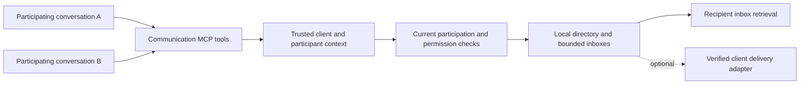

- [x] Inspect current client identity, MCP session lifecycle, virtual servers, privacy gates, and recent conversation plans.
- [x] Check official MCP and Claude documentation for conversation identity and message delivery limitations.
- [x] Compare within-client and cross-client scopes; propose a minimal first release.
- [ ] Phase 0: prove identity and delivery with two real conversations in the intended Claude app.
- [ ] Phase 1: implement trusted participant registration and bounded same-client mailboxes.
- [ ] Phase 2: expose MCP tools, permissions, and minimal desktop controls; verify two-session exchange.
- [ ] Phase 3: optionally add a proven Claude Code delivery adapter.
- [ ] Future decision: consider explicit cross-client collaboration spaces after validating the within-client workflow.
- [ ] Plan Review after implementation: compare every specified behavior with the code and implement omissions.
- [ ] Test Coverage Review after implementation: cover modified paths, edge cases, and failures.
- [ ] Bug Hunt after implementation: inspect identity, authorization, lifecycle, races, bounds, and privacy.
- [ ] Run applicable local Rust, frontend, website, and native-client checks before any implementation commit.
- [ ] Commit and push completed, validated implementation and automatic catalog updates, preserving unrelated changes.
- [x] Review and validate this planning document for its separate documentation-only commit and push.

# Session communication within and across clients

Date: 2026-10-29. Status: proposed feature; this task delivers a plan only, with no application changes. Repository baseline inspected: `c3a49e10`.

## Recommendation

Start with **participating conversations inside one configured LocalRouter client**. They can publish a short description, discover peers, exchange direct messages, and reply. Keep the broker independent of Claude so another integration can use it later.

Defer cross-client access until the first workflow is useful. Later, add explicit collaboration spaces containing selected LocalRouter client IDs. Do not introduce a global directory or infer permission from app brand, project path, or shared machine.

The first integration candidate is Claude Code because it exposes documented lifecycle hooks and an optional push mechanism. The user has not yet specified Claude Code versus Claude Desktop. Phase 0 must verify the intended app; Desktop support must not inherit assumptions from Code.

The product promise is: **“Participating sessions can find one another and exchange messages through LocalRouter.”** “Every loaded Claude chat is automatically visible and can be interrupted” is a different promise and is not established by current MCP connectivity.

## What the user experience should be

1. Enable Session Communication on the existing Claude client. Explain that participating sessions using this credential share a communication scope, including sessions in different projects.
2. In two conversations, ask them to participate as “Implement authentication” and “Review authentication tests.” A supported, explicitly installed adapter may enroll active sessions automatically; plain MCP participation uses a join tool.
3. The implementation session lists peers and sees the reviewer’s deliberately published name, brief task description, recent activity, and delivery capability.
4. It sends: “I changed the token-refresh interface. Please check the retry behavior.”
5. The reviewer checks its inbox, or receives an event through a supported adapter, and replies against the original message ID.
6. The sender can distinguish queued, collected, and replied messages. Neither session receives the other’s transcript, credentials, filesystem access, or tool permissions.

Enrollment can be explicit per conversation without a manual LocalRouter UI action each time: the agent can call the join tool when asked to collaborate. Enabling an adapter at an approved project scope can automate participation there. Existing sessions may require configuration reload or restart; verify their actual callable tools.

Do not build project rooms, broadcasting, shared transcripts, automatic task delegation, spawning agents, or a workflow scheduler in v1. Communication coordinates independent sessions; file conflicts and their execution remain the sessions’ responsibility.

## Scope choice

| Choice | Benefit | Cost | Recommendation |
| --- | --- | --- | --- |
| Same configured client | Directly serves multiple Claude sessions; one existing policy boundary | Must distinguish actual conversations and delivery behavior | First release |
| Explicit cross-client spaces | Claude implements while another app reviews; different tools/models cooperate | Adds membership, bilateral policy, provider/privacy boundaries, and revocation cases | Later, using the same broker |
| All clients discover each other | Minimal setup | Exposes unrelated sessions and bypasses existing credential boundaries | Do not offer |

A “client” here means a saved LocalRouter credential and configuration, not a software brand. Two Claude configurations with different credentials are cross-client. Different apps sharing one credential are within one client. Separate client entries remain the way to separate trust boundaries in v1.

## Current code and protocol constraints

| Finding | Consequence | Evidence |
| --- | --- | --- |
| `Client` is persistent configuration; gateway sessions are runtime connections | Neither is inherently one Claude conversation | `crates/lr-config/src/types.rs`, `crates/lr-clients/src/manager.rs` |
| Legacy SSE and stateful Streamable HTTP can separate connections; headerless/stateless paths can share `client_id` | Do not register the client-wide fallback as a unique conversation | `crates/lr-server/src/routes/mcp.rs`, `crates/lr-mcp/src/gateway/gateway.rs`, `gateway/types.rs` |
| Monitor conversation groups are bounded diagnostic correlation and can be inferred | Never use them as messaging addresses or authorization identity | `crates/lr-monitor/src/conversation.rs`, `plan/2026-10-29-MONITOR_CONVERSATION_BEHAVIOR.md` |
| Virtual MCP servers already provide tools, instructions, per-session state, and permission hooks | Implement as a small built-in virtual server plus local broker | `crates/lr-mcp/src/gateway/virtual_server.rs` |
| Virtual tool dispatch currently receives client identity but no trusted conversation context | Add a narrow trusted invocation context before peer operations | `crates/lr-mcp/src/gateway/gateway_tools.rs` |
| Scoped notifications already exist, but the current stdio bridge only forwards sequential HTTP requests | Existing bridges cannot be assumed to receive push events or preserve conversation identity | `gateway/types.rs`, `crates/lr-mcp/src/bridge/stdio_bridge.rs` |
| Restricted privacy profiles already reject MCP ingress | Preserve this restriction on every new adapter/broker ingress | `crates/lr-server/src/privacy.rs`, `crates/lr-config/src/client_security.rs` |

Older MCP transport sessions describe client/server interactions, not user conversations. Revision 2026-07-28 removes protocol-level HTTP sessions, reinforcing the need for an application-level participant identity. See the official [older session contract](https://modelcontextprotocol.io/specification/2025-11-25/basic/transports#session-management) and [current HTTP transport](https://modelcontextprotocol.io/specification/2026-07-28/basic/transports/streamable-http).

MCP resource updates are application-controlled signals; they do not guarantee a model turn. Use tool-based inbox retrieval as the portable baseline. Adding virtual resources would also expand the existing tool-only virtual-server interface. See [MCP resources](https://modelcontextprotocol.io/specification/2026-07-28/server/resources).

## Identity and lifecycle

Keep these identities distinct: authenticated `client_id`, LocalRouter `participant_id`, optional native conversation ID, live connection/adapter binding, and participant generation.

- The server issues opaque participant IDs. Display names and task descriptions are untrusted descriptive metadata.
- Bind peer operations to authenticated client plus a trusted invocation binding. Never accept `from_session_id` or a bare public participant ID as sender authentication.
- An isolated, verified one-conversation connection can carry the binding in gateway virtual-session state. A native adapter must supply a server-authenticated per-conversation binding independently of HTTP transport sessions. Reject ambiguous shared/stateless connections until such a binding exists.
- Do not rely on a model remembering a self-selected ID. If an application-level capability is needed, keep it in the adapter, out of directory results, tool schemas, logs, and model-visible text. Phase 0 must prove how each tool call reaches the correct binding.
- A short lease records liveness; actual activity and adapter connectivity are separate fields. Report “recently active,” “waiting for inbox check,” or “adapter connected,” rather than asserting a chat tab is loaded or the model is listening.
- A transient transport disconnect does not prove the conversation closed. A verified reconnect may rebind an unexpired participant only with proof of the existing binding. An explicit conversation close/leave, lease expiry, reset/clear, fork, or replacement creates a new generation/address. Old queued messages must never silently redirect to a replacement session.
- Multiple processes resuming the same native conversation must not steal each other’s inbox: use separate live participant instances or explicitly reject duplicate ownership. Treat subagents as part of the parent unless separately enrolled with a proven identity.
- Closing/leaving, disabling the feature/client, deleting the client, configured client credential expiry, or credential revocation ends participation. Every request needs current valid authentication; ordinary OAuth access-token expiry rejects that request, while refresh can restore access to the existing unexpired binding. Crashes rely on lease expiry. LocalRouter restart clears participants and mailboxes in v1.

Sharing one client credential is already sharing an authentication boundary. Conversation binding prevents accidental routing and ordinary ID spoofing; this feature does not promise isolation from a malicious process holding that same credential.

## Proposed tools and message contract

Names below are proposals, to be aligned with existing built-in naming during implementation.

| Tool | Contract |
| --- | --- |
| `SessionJoin` | Enroll/update this bound conversation’s name and short purpose; return its public participant ID and delivery mode |
| `SessionList` | Return only visible, enrolled peers in this client’s authorized scope; exclude self; paginate |
| `SessionSend` | Send plain text to one recipient, with a request idempotency key and optional `reply_to`; return message ID and queued status |
| `SessionReceive` | Fetch this participant's bounded page of messages and receipt events; accept acknowledgments for previously collected IDs; never select another participant's inbox |
| `SessionLeave` | Revoke this enrollment/address and participant capability; purge its pending inbox; preserve the proven conversation binding so it can rejoin with a fresh generation |

The envelope contains a server message ID, trusted sender/recipient identities and generations, server time, expiry, plain-text body, and optional reply linkage. The server validates that `reply_to` belongs to an exchange visible to both participants. No attachments, remote URLs fetched by LocalRouter, transcript references, automatic execution, or structured action payloads. Plain-text code snippets are valid messages.

`SessionSend` is nonblocking with respect to the recipient. A recipient may reply later; sender tools never wait indefinitely for a model response. Use immediate inbox fetch in v1; bounded waiting can be added only if real client testing justifies it.

Use at-least-once collection until acknowledgment, rather than deleting before a tool response reaches the caller. Acknowledgment means collection, not understanding or successful work. Scope idempotency to sender generation and request key; a retry with a different payload fails. Retain bounded deduplication records for a documented retry window and return a clear result for a duplicate already expired or revoked.

Status vocabulary: **queued**, **collected** (fetched by the recipient tool/adapter), **acknowledged** (explicit recipient-agent receipt), **replied**, and **expired/revoked**. An optional channel handoff means only that the adapter wrote to its transport. Neither adapter collection nor handoff proves model consumption. A successful socket write is never “read” or “acted on.” No durable or exactly-once promise is made.

Send bounded status receipts to the sender's `SessionReceive` feed, with an explicit message/receipt event discriminator, so it can observe collection, acknowledgment, reply, and expiry after the initial queued result. Apply policy and generation checks to receipts too, avoid recursive receipts for receipts, and expire them within the same memory and retention budget. Once receipt history expires, return status unavailable rather than inventing a delivery outcome.

Use explicit text/byte/count limits from the first implementation. Initial values to validate: 4 KiB text per message, 100 queued messages or 512 KiB per participant (first limit wins), 4 MiB per client, 16 MiB globally, 15-minute message expiry, 20 sends per minute per sender, and 60 per recipient. Bound participants, directory pages, receipt history, deduplication records, and cleanup work as well. Reject a full inbox; never silently discard pending messages to accept a new one. Use a monotonic clock for runtime expiry.

## Permission and privacy behavior

- Add a default-Off per-client Session Communication setting. Reuse Off/Ask/Allow conventions. Joining requires enabled policy and a proven conversation binding; listing, sending, and receiving require active enrollment. Sending and receiving check current policy for both parties.
- With Ask, enrollment needs a participation approval for that conversation. The first send establishes a separate exchange grant covering the specific sender, recipient, scope, and participant generations; the approved exchange can include replies. Tool-name-only session approval is too broad. Inbox reads/receipts recheck that grant without prompting for every collection.
- Recheck current policy at enqueue, collection, and acknowledgment. Revocation removes visibility, invalidates grants, and purges undelivered content involving the revoked participant. Use the same unavailable response for hidden, expired, or unknown targets when the caller is unauthorized to distinguish them.
- Render peer messages as attributed untrusted content. They convey no system authority, approval, credentials, or access to the recipient’s tools. Prevent raw markup from impersonating host-generated envelopes. Enforce loop/rate budgets for automated replies; no default auto-reply loop or recursive delegation.
- Publish only supplied short names and purposes. Do not derive directory titles from Monitor prompts, read transcripts, or expose roots, native IDs, raw tokens, model configuration, or client secrets.
- Keep inboxes in bounded memory only. Do not automatically write messages to Memory, searchable context stores, replay payloads, or tool-result indexing. Mark all communication tools non-indexable and review generic tool-call capture paths as well.
- Monitor may record bounded IDs, sizes, timing, and outcome under current privacy settings; message bodies are omitted by default. Any later body inspection needs explicit product design and existing payload/redaction controls. Metadata-only settings must suppress body capture across desktop events, logs, errors, and demos.
- Preserve current MCP rejection for `local_only` and `no_retention` profiles; a new adapter endpoint must not become a bypass. No relaxed “RAM does not count” exception. Changing these profiles is outside this feature.
- Explain accurately: **LocalRouter relays locally, but a recipient may include the message in its next model-provider request.** LocalRouter makes no extra inference requests for discovery, titles, or delivery. There is no telemetry, external asset loading, public relay, or cross-device delivery.

## Delivery integrations

| Mode | Supported promise | Release position |
| --- | --- | --- |
| MCP tools only | A correctly bound participant can discover/send/check its inbox during a turn | Portable baseline, subject to identity proof |
| Claude Code hooks | Native session registration; optional inbox hint/context at prompt/tool boundaries | First adapter candidate if needed for useful UX |
| Claude Code Channels | Events enter an opted-in running session; busy sessions may process them later | Optional experimental push integration |
| Claude Desktop Chat | Must verify per-chat binding and host delivery behavior | No automatic per-chat discovery/wake promise yet |

Claude Code hooks expose `session_id`; returned context is consumed on a later model request. Use only lifecycle fields needed for identity. Avoid transcripts and transcript watching. Prefer a bounded “messages waiting” hint leading to an inbox tool over arbitrary message bodies inserted by hooks. Keep integration scoped to the approved project unless the user requests global configuration. See [hooks reference](https://code.claude.com/docs/en/hooks).

Claude Code Channels are a research preview using a local stdio subprocess with `claude/channel` and `notifications/claude/channel`. Custom channels currently need development opt-in or approved distribution; organization policy may prevent them. They offer a route to push, with no recipient acknowledgment guarantee. See [Channels reference](https://code.claude.com/docs/en/channels-reference).

Current Claude Code docs also say channels negotiating MCP 2026-07-28 are not registered. Prototype an earlier-protocol adapter locally; avoid changing every configured server’s protocol or enabling telemetry/flag fetching for this feature. If it cannot work under the user’s existing settings, show it as unavailable. See [MCP channel compatibility](https://code.claude.com/docs/en/mcp#push-messages-with-channels). Recheck these preview limitations at implementation time.

An adapter is a thin per-conversation bridge to the same broker, not a second messaging system. Keep push optional; do not repurpose sampling or resource-list notifications to imply an existing chat received a user turn. Desktop support needs its own proof with local MCP connectivity; do not expose LocalRouter publicly to make a cloud connector reach localhost.

## Implementation shape

Reuse `lr-mcp` and its virtual-server infrastructure. Avoid a new crate, persistence layer, or generalized orchestration framework.

Extend virtual-call context narrowly with authenticated identity and the verified participant binding. Store shared directory/mailboxes in one service and per-connection references in virtual session state. Do not clone mutable inboxes into per-call state. Keep session/broker locks out of network delivery and approval awaits; enforce policy versions/generations when returning from those awaits.

Likely touched areas:

- `crates/lr-mcp/src/gateway/`: communication virtual server/broker, trusted dispatch context, participant cleanup, listing-change snapshots, instructions, and indexing exclusion.
- `crates/lr-config/`: default-Off client policy, validation, serialization/backward compatibility, and current-policy lookup.
- `crates/lr-server/` and application startup: broker wiring and authenticated adapter access only if phase 0 proves an adapter necessary. Annotate/document any new HTTP endpoints with existing OpenAPI conventions; no redundant public REST messaging API.
- `src/views/clients/`: a Session Communication card under Client → MCP; simple participant/status view with withdrawal and administrator revocation controls. No separate global chat application or permanent message history.
- `src-tauri/src/ui/`, `src/types/tauri-commands.ts`, and `website/src/components/demo/TauriMockSetup.ts`: synchronized commands/types/demo data for the settings and participant view. Rust snake_case params, frontend camelCase, nullable optional fields, established icons, and Radix dialogs.

## Implementation phases and acceptance gates

**Phase 0 — verify the real app before fixing the API.** Run two actual Claude conversations sharing one configured client. Record software versions, native conversation identity across processes/tabs, MCP protocol and connection behavior, and callable tool discovery. Test startup, resume, `/clear`, compaction, reconnect, crash, and concurrent resume. Verify both idle and busy delivery. One session must not fetch another’s inbox by claiming its public ID. If identity cannot be bound reliably, stop that integration claim and implement the narrow adapter before presenting it as supported. This planning task inspected code/docs only; no native experiment has been run.

**Phase 1 — broker and identity.** Implement default-Off policy, verified registration, generations/leases, same-client scope, direct messages, receipts, deduplication, expiry, revocation, and memory/rate bounds. Cross-client access is hard-denied. Keep the policy entry point reusable without shipping dormant cross-client configuration.

**Phase 2 — useful within-client experience.** Add the five tools and concise instructions, pairing-aware Ask behavior, settings, participants/status view, privacy-safe Monitor metadata, mocks/types, and two real conversations exchanging a review request and reply. Verify the actual session loaded the integration. Tool-only mode must clearly show that inbox checks are required; a minimal identity/hook adapter may be part of this phase if phase 0 requires it.

**Phase 3 — optional automatic delivery.** Prototype Claude Code hooks/channels against the same inbox. Add explicit setup and capability reporting only after real tests prove it works. Preserve pending messages when notification delivery fails. Track adapter collection, channel transport handoff, and explicit recipient-agent acknowledgment separately. Core mailbox rollout need not depend on research-preview push support.

**Later — explicit cross-client spaces.** Proceed only after a useful same-client trial. The user creates a space and selects client memberships; both clients opt in. Directory visibility, send, and receive all check membership and current policy. Include source client attribution and provider/privacy implications. Removal invalidates grants and purges pending content immediately. Project paths remain labels, not authorization. No agent can add a client to a space. Messages retain their original sender; the receiving client grants no inherited tool/model authority.

## Required validation for implementation

Test two conversations on one credential, two credentials using the same app, different apps sharing one credential, spoofed IDs/bindings, ambiguous stateless transport, native-ID collisions, reinitialize/reconnect/reset/fork, stale generations, crash/lease expiry, and client credential expiry/deletion. Test revocation during approval, enqueue, fetch, notification, and acknowledgment; enforce a documented atomic policy boundary.

Test concurrent sends/readers, order within an inbox, duplicate/reordered retries, acknowledgment ownership, forged reply links, queue/byte/rate limits, cleanup bounds, Unicode byte limits, full queues, partial adapter failure, no listeners, expired messages, process restart, and error redaction. Verify that bodies never enter Monitor/indexing/Memory/logs through generic tool arguments or response previews. A recipient reply loop must remain bounded and cancellable.

Verify no tool exposure or background work when Off, live listing refresh or honest reload guidance when enabled, existing privacy ingress on every path, no additional model requests, and no reliance on Monitor retention. Native acceptance requires an actual message and reply between two independently addressable sessions, not only a successful MCP handshake or notification write.

For Rust/workspace changes, update and pin rustup stable, confirm actual compiler path, then run workspace Clippy with all targets and warnings denied, formatting check, and workspace tests per AGENTS.md. For desktop/shared frontend, run `npx tsc --noEmit`, `npm run test:unit`, `npm run build`, and `npm --prefix website run build:check` with dependencies installed. Run packaging-script tests if adapter packaging changes those scripts. Do not dispatch hosted CI unless requested; an ordinary master push does not imply hosted validation.

Complete the checklist’s Plan Review, Test Coverage Review, and Bug Hunt after implementation, fix findings, then commit/push validated changes with Conventional Commits and any automatic catalog update. Preserve unrelated user files. Implementation must be a separately requested task.

## Planning-delivery validation

Reviewed against current repository code and official protocol/client documentation, with independent architecture, product/privacy, and protocol reviews. Corrected enrollment approval, rejoin/reconnect behavior, OAuth refresh semantics, and sender receipt visibility. Checked repository references, Markdown structure, and whitespace; only this plan belongs to the task diff. No Rust or frontend builds were run for this documentation-only task. No native Claude compatibility result is claimed. Commit/push outcome is reported with delivery.
